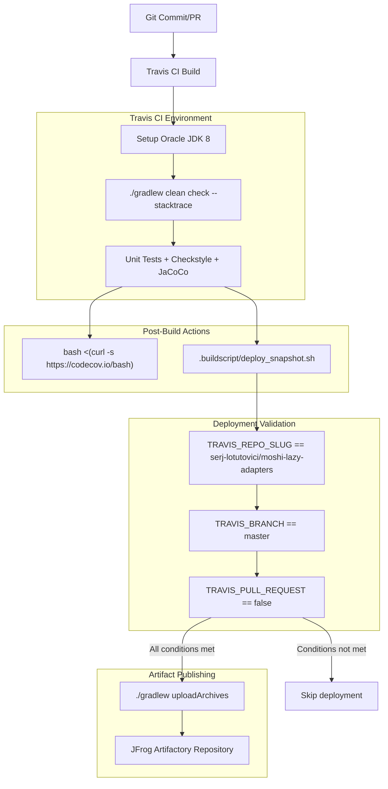
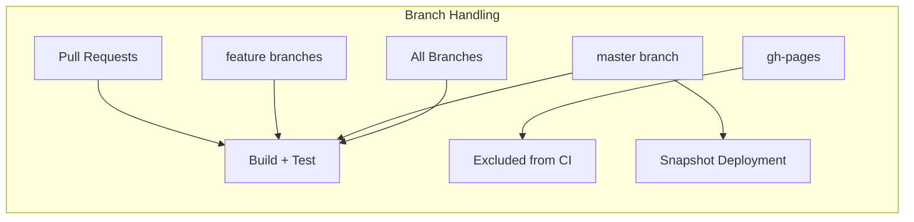
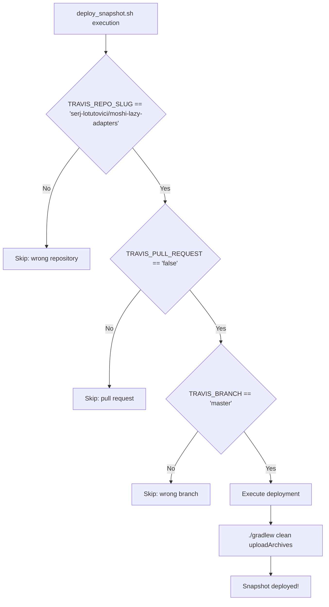
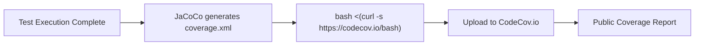

# CI/CD and Deployment

<details>
<summary>Relevant source files</summary>

The following files were used as context for generating this wiki page:

- [.buildscript/deploy_snapshot.sh](.buildscript/deploy_snapshot.sh)
- [.travis.yml](.travis.yml)

</details>


This document covers the continuous integration, testing, and deployment pipeline for the moshi-lazy-adapters library. It details the Travis CI configuration, automated deployment processes, and integration with external services like CodeCov for coverage reporting and JFrog Artifactory for artifact publishing.

For information about the build system and Gradle configuration that supports these CI/CD processes, see [Build System](#3.2). For details about the testing framework that runs during CI, see [Testing](#3.3).

## CI/CD Pipeline Overview

The moshi-lazy-adapters library uses Travis CI for continuous integration and automated deployment. The pipeline executes on every commit and handles both validation builds for pull requests and snapshot deployments for master branch commits.



Sources: [.travis.yml:1-28](), [.buildscript/deploy_snapshot.sh:1-23]()

## Travis CI Configuration

The Travis CI configuration uses Oracle JDK 8 and executes a comprehensive build and test process. The main configuration is defined in the root `.travis.yml` file.

### Build Environment

| Configuration | Value |
|---------------|-------|
| Language | `java` |
| JDK Version | `oraclejdk8` |
| Cache | `$HOME/.gradle` |
| Notifications | Email disabled |

The build script executes `./gradlew clean check --stacktrace` which runs all tests, code quality checks, and builds the library artifacts.

Sources: [.travis.yml:1-7](), [.travis.yml:25-27]()

### Branch Configuration

Travis CI is configured to build all branches except `gh-pages`. The deployment process specifically targets the `master` branch for snapshot releases.



Sources: [.travis.yml:18-20]()

## Deployment Process

The deployment process is handled by the `deploy_snapshot.sh` script, which validates deployment conditions and publishes artifacts to the configured repository.

### Deployment Conditions

The deployment script implements multiple validation checks before proceeding with artifact publication:



The validation logic ensures deployments only occur for:
- The correct repository slug: `serj-lotutovici/moshi-lazy-adapters`
- Non-pull request builds
- Commits to the `master` branch

Sources: [.buildscript/deploy_snapshot.sh:8-18]()

### Artifact Upload

When deployment conditions are met, the script executes the Gradle `uploadArchives` task with encrypted credentials:

```bash
./gradlew clean uploadArchives -PnexusUsername="$TRAVIS_USER_NAME" -PnexusPassword="$TRAVIS_PASSWORD"
```

The `TRAVIS_USER_NAME` and `TRAVIS_PASSWORD` environment variables are securely encrypted in the Travis configuration and provide authentication for the artifact repository.

Sources: [.buildscript/deploy_snapshot.sh:21]()

## Code Coverage Integration

The CI pipeline integrates with CodeCov.io for automated code coverage reporting. After successful test execution, coverage data is uploaded using the official CodeCov bash script.

### Coverage Upload Process



The coverage upload occurs in the `after_success` phase of the Travis build, ensuring it only runs when tests pass successfully.

Sources: [.travis.yml:9-10]()

## Environment Configuration

The Travis CI environment includes encrypted environment variables for secure credential management during deployment.

### Encrypted Variables

The configuration includes two encrypted environment variables:
- `TRAVIS_USER_NAME`: Username for artifact repository authentication
- `TRAVIS_PASSWORD`: Password for artifact repository authentication

These encrypted values are defined in the `env.global` section and are automatically decrypted during builds in the target repository.

### Gradle Daemon Caching

The configuration enables Gradle daemon caching by specifying `$HOME/.gradle` in the cache directories. This improves build performance by preserving Gradle's build cache and downloaded dependencies between builds.

Sources: [.travis.yml:13-16](), [.travis.yml:25-27]()

## Integration with Build System

The CI/CD pipeline integrates with the project's Gradle build system through specific tasks and configurations:

- **Test Execution**: The `check` task runs unit tests, Checkstyle validation, and JaCoCo coverage analysis
- **Artifact Publishing**: The `uploadArchives` task publishes built artifacts to the configured Maven repository
- **Clean Builds**: Each deployment starts with `clean` to ensure reproducible builds

The deployment process specifically uses Gradle properties (`-PnexusUsername` and `-PnexusPassword`) to pass authentication credentials to the Maven publishing configuration.

Sources: [.travis.yml:7](), [.buildscript/deploy_snapshot.sh:21]()
