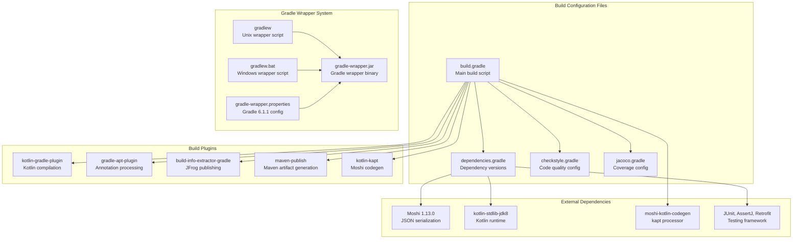
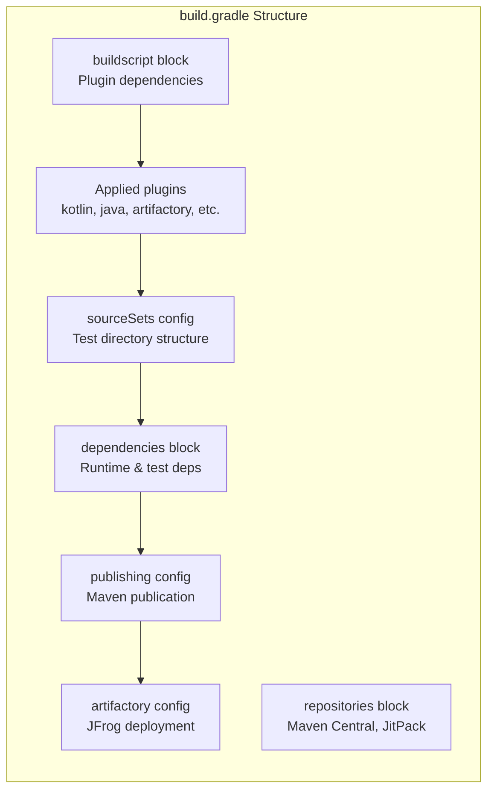
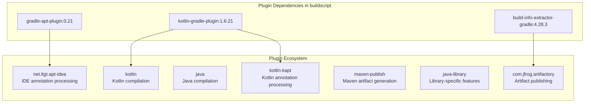
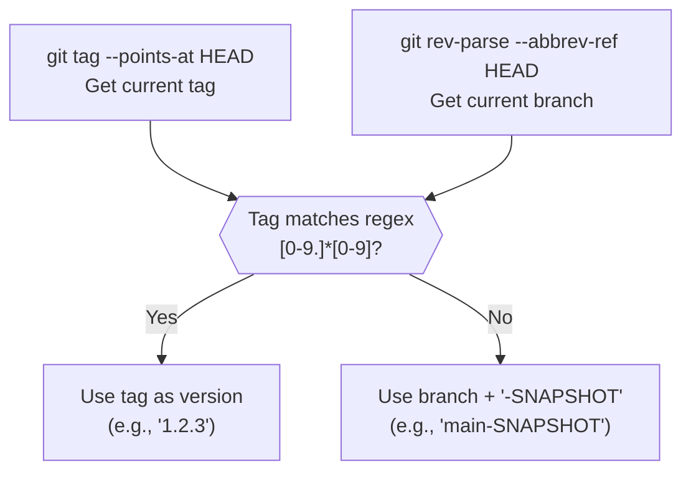
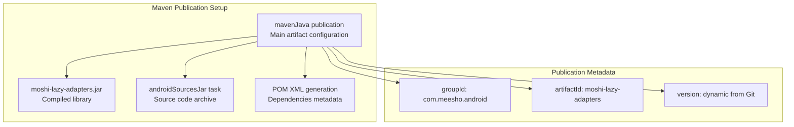

# Build System

Relevant source files

The following files were used as context for generating this wiki page:

- [build.gradle](build.gradle)
- [dependencies.gradle](dependencies.gradle)
- [gradle/wrapper/gradle-wrapper.jar](gradle/wrapper/gradle-wrapper.jar)
- [gradle/wrapper/gradle-wrapper.properties](gradle/wrapper/gradle-wrapper.properties)
- [gradlew](gradlew)
- [gradlew.bat](gradlew.bat)

This document covers the build configuration, dependency management, and artifact publishing setup for the moshi-lazy-adapters library. For information about continuous integration and deployment processes, see [CI/CD and Deployment](#4). For details about code quality enforcement, see [Code Quality](#3.4).

## Overview

The moshi-lazy-adapters project uses Gradle as its build system with a multi-layered configuration approach. The build system handles Kotlin/Java compilation, annotation processing, testing, code quality enforcement, and artifact publishing to JFrog Artifactory.

Sources: [build.gradle:1-135](), [dependencies.gradle:1-18](), [gradle/wrapper/gradle-wrapper.properties:1-6]()

## Build Script Structure

### Main Build Configuration

The primary build configuration is defined in `build.gradle` with a modular approach that imports additional configuration files:

- **Plugin Management**: Configured in the `buildscript` block with repository and classpath dependencies
- **Applied Plugins**: Multiple plugins are applied for different build aspects
- **External Configuration**: Imports specialized configuration files for dependencies, code quality, and coverage

Sources: [build.gradle:1-35](), [build.gradle:41-71](), [build.gradle:94-135]()

### Dependency Management

Dependencies are externalized to `dependencies.gradle` for centralized version management:

| Dependency Category | Libraries | Version |
|-------------------|-----------|---------|
| **Core Runtime** | `moshi` | 1.13.0 |
| **Kotlin** | `kotlin-stdlib-jdk8` | 1.6.21 |
| **Annotation Processing** | `moshi-kotlin-codegen` | 1.13.0 |
| **Testing Framework** | `junit` | 4.12 |
| **Testing Assertions** | `assertj-core` | 2.5.0 |
| **HTTP Testing** | `retrofit`, `mockwebserver` | 2.1.0, 3.4.1 |
| **Reactive Testing** | `rxjava` | 2.0.3 |

Sources: [dependencies.gradle:6-17](), [build.gradle:49-61]()

## Plugin Configuration

### Core Build Plugins

The build system applies several plugins with specific purposes:

Sources: [build.gradle:14-18](), [build.gradle:25-31]()

### Annotation Processing Setup

The build configures Kotlin annotation processing (kapt) specifically for Moshi code generation:

- **kapt Dependency**: `moshi-kotlin-codegen:1.13.0` processes Moshi annotations
- **Kotlin Compilation**: Targets JVM version 11 for both main and test sources
- **Source Sets**: Custom test source directory structure at `src/unitTest/java`

Sources: [build.gradle:52](), [build.gradle:62-71](), [build.gradle:41-47]()

## Version Management

### Dynamic Version Generation

The build implements a Git-based versioning strategy using shell commands:

The `versionName()` function determines the artifact version by checking if the current HEAD has a semantic version tag, otherwise using the branch name with `-SNAPSHOT` suffix.

Sources: [build.gradle:72-82]()

### Build Properties

Key build properties are configured for the project:

- **Library Group ID**: `com.meesho.android`
- **Artifact ID**: `moshi-lazy-adapters`
- **Java Compatibility**: Source and target compatibility set to Java 11
- **Kotlin JVM Target**: Version 11 for both compilation tasks

Sources: [build.gradle:38-39](), [build.gradle:84-85](), [build.gradle:62-71]()

## Gradle Wrapper Configuration

### Wrapper Setup

The project uses Gradle Wrapper version 6.1.1 for reproducible builds:

| Configuration | Value |
|--------------|--------|
| **Distribution URL** | `https://services.gradle.org/distributions/gradle-6.1.1-bin.zip` |
| **Distribution Base** | `GRADLE_USER_HOME` |
| **Distribution Path** | `wrapper/dists` |
| **Zip Store Base** | `GRADLE_USER_HOME` |
| **Zip Store Path** | `wrapper/dists` |

The wrapper ensures all developers and CI systems use the same Gradle version regardless of local installations.

Sources: [gradle/wrapper/gradle-wrapper.properties:1-6]()

### Wrapper Scripts

Two platform-specific wrapper scripts provide entry points to the build system:

- **Unix/Linux/macOS**: `gradlew` - Bash script with environment detection and Java path resolution
- **Windows**: `gradlew.bat` - Batch script with Windows-specific path handling

Both scripts locate the appropriate Java executable and delegate to the Gradle Wrapper JAR with proper classpath configuration.

Sources: [gradlew:1-173](), [gradlew.bat:1-85]()

## Artifact Publishing

### Maven Publication Configuration

The build generates Maven-compatible artifacts for distribution:

The `androidSourcesJar` task creates a sources archive from `sourceSets.main.java.srcDirs`, and POM generation automatically includes implementation dependencies.

Sources: [build.gradle:87-90](), [build.gradle:94-115]()

### JFrog Artifactory Integration

Artifact deployment is configured for JFrog Artifactory with environment-based configuration:

- **Repository Selection**: Automatic selection between snapshot and release repositories based on version suffix
- **Authentication**: Uses project properties for username and API key
- **Publication Target**: Publishes the `mavenJava` publication with artifacts and POM

The system uses these project properties:
- `JFROG_ARTIFACTORY_URL`: Base Artifactory URL
- `JFROG_ARTIFACTORY_USERNAME`: Authentication username  
- `JFROG_ARTIFACTORY_KEY`: API key for authentication
- `SNAPSHOT_REPO_NAME`: Repository for snapshot versions
- `RELEASE_REPO_NAME`: Repository for release versions

Sources: [build.gradle:117-135]()
