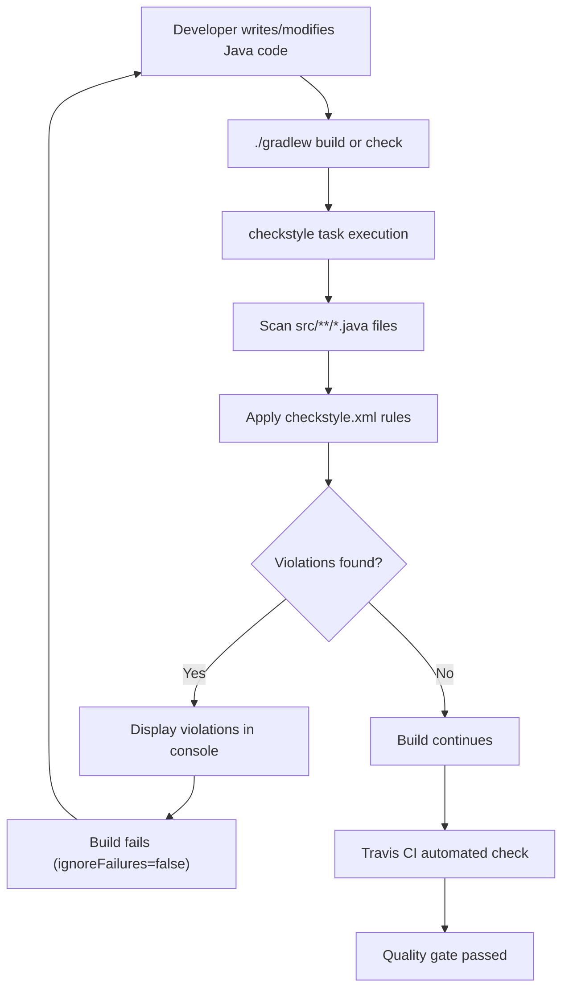
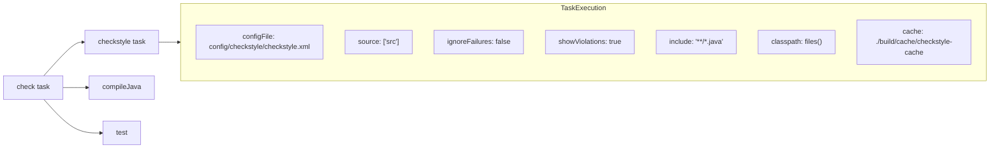

# Code Quality

Relevant source files

The following files were used as context for generating this wiki page:

- [checkstyle.gradle](checkstyle.gradle)
- [config/checkstyle/checkstyle.xml](config/checkstyle/checkstyle.xml)

This document describes the code quality standards, tools, and enforcement mechanisms used in the moshi-lazy-adapters library. It covers Checkstyle configuration, coding standards, and the quality assurance workflow integrated into the build system.

For information about testing practices and code coverage, see [Testing](#3.3). For details about the build system that integrates these quality checks, see [Build System](#3.2).

## Quality Enforcement Overview

The library uses Checkstyle as the primary code quality enforcement tool, integrated directly into the Gradle build system to ensure consistent code standards across all Java source files.

### Quality Enforcement Workflow

**Sources:** [checkstyle.gradle:1-25](), [config/checkstyle/checkstyle.xml:1-172]()

### Checkstyle Configuration

The Checkstyle setup uses version 6.0 and is configured through two key files:

| Configuration Aspect | Value | Location |
|---------------------|-------|----------|
| Checkstyle Version | 6.0 | [checkstyle.gradle:4]() |
| Configuration File | `config/checkstyle/checkstyle.xml` | [checkstyle.gradle:8]() |
| Source Directories | `['src']` | [checkstyle.gradle:9]() |
| File Pattern | `**/*.java` | [checkstyle.gradle:12]() |
| Failure Policy | `ignoreFailures false` | [checkstyle.gradle:10]() |
| Cache Location | `./build/cache/checkstyle-cache` | [checkstyle.gradle:17]() |

**Sources:** [checkstyle.gradle:1-25]()

## Code Standards and Rules

The Checkstyle configuration enforces comprehensive coding standards organized into several categories:

### Checkstyle Rule Categories

```mermaid
graph TD
    CheckstyleRoot["Checkstyle Rule Enforcement"]
    
    FileLevel["File-Level Checks"]
    FileLength["FileLength"]
    FileTabCharacter["FileTabCharacter"] 
    TrailingSpaces["RegexpSingleline: trailing spaces"]
    SpaceAfterKeywords["RegexpSingleline: space after for/if"]
    ForEachSpacing["RegexpSingleline: colon spacing"]
    
    TreeWalkerChecks["TreeWalker Module Checks"]
    
    NamingConventions["Naming Conventions"]
    ConstantName["ConstantName"]
    MethodName["MethodName: ^[a-z][a-zA-Z0-9_]*$"]
    TypeName["TypeName: ^[A-Z][a-zA-Z0-9_]*$"]
    LocalVariableName["LocalVariableName"]
    ParameterName["ParameterName"]
    
    ImportChecks["Import Management"]
    AvoidStarImport["AvoidStarImport"]
    UnusedImports["UnusedImports"]
    RedundantImport["RedundantImport"]
    
    SizeViolations["Size Constraints"]
    LineLength["LineLength: max=100"]
    
    WhitespaceRules["Whitespace Standards"]
    GenericWhitespace["GenericWhitespace"]
    OperatorWrap["OperatorWrap"]
    WhitespaceAround["WhitespaceAround"]
    ParenPad["ParenPad"]
    
    CodingProblems["Coding Best Practices"]
    EqualsHashCode["EqualsHashCode"]
    EmptyStatement["EmptyStatement"]
    SimplifyBooleanExpression["SimplifyBooleanExpression"]
    MissingSwitchDefault["MissingSwitchDefault"]
    
    CustomJUnitChecks["Custom Assertion Checks"]
    NoJUnitEquals["Block JUnit assertEquals"]
    NoJUnitNull["Block JUnit assertNull"]
    PreferAssertJ["Enforce AssertJ usage"]
    
    CheckstyleRoot --> FileLevel
    CheckstyleRoot --> TreeWalkerChecks
    
    FileLevel --> FileLength
    FileLevel --> FileTabCharacter
    FileLevel --> TrailingSpaces
    FileLevel --> SpaceAfterKeywords
    FileLevel --> ForEachSpacing
    
    TreeWalkerChecks --> NamingConventions
    TreeWalkerChecks --> ImportChecks
    TreeWalkerChecks --> SizeViolations
    TreeWalkerChecks --> WhitespaceRules
    TreeWalkerChecks --> CodingProblems
    TreeWalkerChecks --> CustomJUnitChecks
    
    NamingConventions --> ConstantName
    NamingConventions --> MethodName
    NamingConventions --> TypeName
    NamingConventions --> LocalVariableName
    NamingConventions --> ParameterName
    
    ImportChecks --> AvoidStarImport
    ImportChecks --> UnusedImports
    ImportChecks --> RedundantImport
    
    SizeViolations --> LineLength
    
    WhitespaceRules --> GenericWhitespace
    WhitespaceRules --> OperatorWrap
    WhitespaceRules --> WhitespaceAround
    WhitespaceRules --> ParenPad
    
    CodingProblems --> EqualsHashCode
    CodingProblems --> EmptyStatement
    CodingProblems --> SimplifyBooleanExpression
    CodingProblems --> MissingSwitchDefault
    
    CustomJUnitChecks --> NoJUnitEquals
    CustomJUnitChecks --> NoJUnitNull
    CustomJUnitChecks --> PreferAssertJ
```

**Sources:** [config/checkstyle/checkstyle.xml:6-172]()

### Key Coding Standards

#### Naming Conventions
- **Methods**: Must follow camelCase pattern `^[a-z][a-zA-Z0-9_]*$`
- **Types**: Must start with uppercase `^[A-Z][a-zA-Z0-9_]*$`
- **Constants**: Must follow SCREAMING_SNAKE_CASE
- **Local variables**: Standard Java naming conventions

#### File and Format Standards
- **Line Length**: Maximum 100 characters per line
- **No Tab Characters**: Only spaces for indentation
- **No Trailing Spaces**: Lines must not end with whitespace
- **Keyword Spacing**: Space required after `for` and `if` keywords
- **Colon Spacing**: Spaces required around `:` in enhanced for loops

#### Import Management
- **No Star Imports**: Explicit imports required (`import pkg.*` forbidden)
- **No Unused Imports**: All imports must be referenced
- **No Redundant Imports**: Imports from same package or `java.lang` forbidden

#### Custom Assertion Standards
The configuration includes custom rules that enforce AssertJ over JUnit assertions:

| Forbidden JUnit Pattern | Required AssertJ Alternative |
|------------------------|------------------------------|
| `assertEquals` | `assertThat(foo).isEqualTo()` |
| `assertNotEquals` | `assertThat(foo).isNotEqualTo()` |
| `assertNull` | `assertThat(foo).isNull()` |
| `assertNotNull` | `assertThat(foo).isNotNull()` |
| `assertSame` | `assertThat(foo).isSameAs()` |

**Sources:** [config/checkstyle/checkstyle.xml:42-54](), [config/checkstyle/checkstyle.xml:69-71](), [config/checkstyle/checkstyle.xml:142-170]()

## Build Integration

### Gradle Task Configuration

The `checkstyle` task is automatically integrated into the build lifecycle:

The `afterEvaluate` block ensures that if a `check` task exists in the project, it will depend on the `checkstyle` task, making quality checks mandatory for successful builds.

**Sources:** [checkstyle.gradle:7-25]()

### Configuration Properties

The Checkstyle task uses specific configuration properties:

| Property | Value | Purpose |
|----------|-------|---------|
| `proj.module.dir` | `projectDir.absolutePath` | Project directory reference for relative paths |
| `checkstyle.cache.file` | `./build/cache/checkstyle-cache` | Cache location for improved performance |

**Sources:** [checkstyle.gradle:15-18]()

## Quality Assurance Integration

The code quality system integrates with the broader CI/CD pipeline:

1. **Local Development**: Developers run `./gradlew check` to verify code quality before commits
2. **CI Pipeline**: Travis CI automatically runs quality checks on every pull request
3. **Build Failure**: Any Checkstyle violations cause immediate build failure
4. **Cache Optimization**: Build cache improves subsequent Checkstyle execution performance

The quality enforcement ensures consistent code style across all contributors and prevents code quality regression in the library.

**Sources:** [checkstyle.gradle:1-25](), [config/checkstyle/checkstyle.xml:1-172]()
