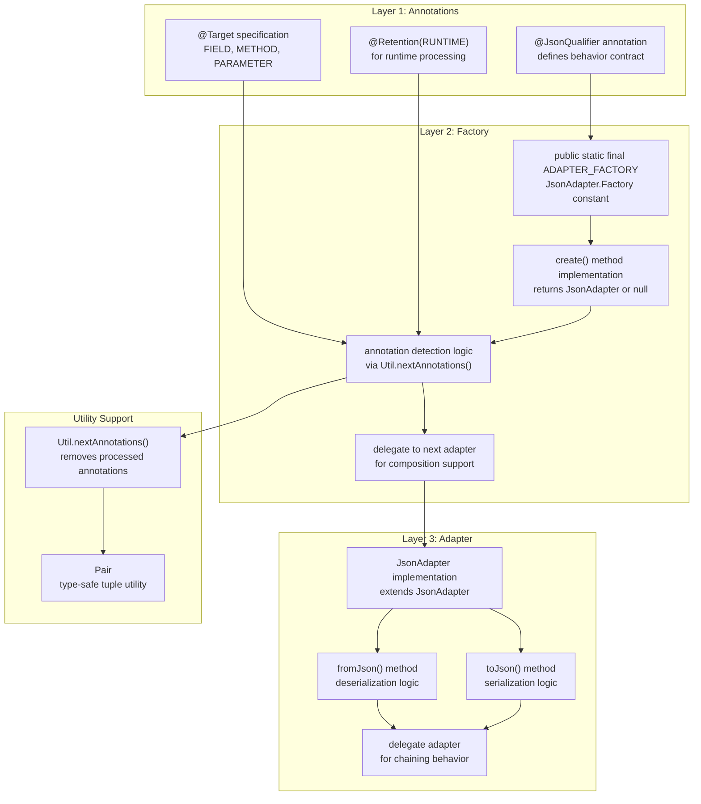
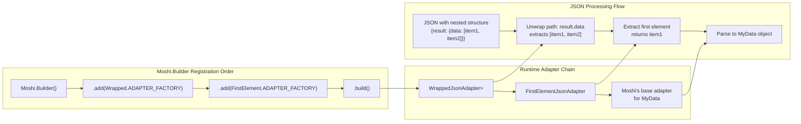
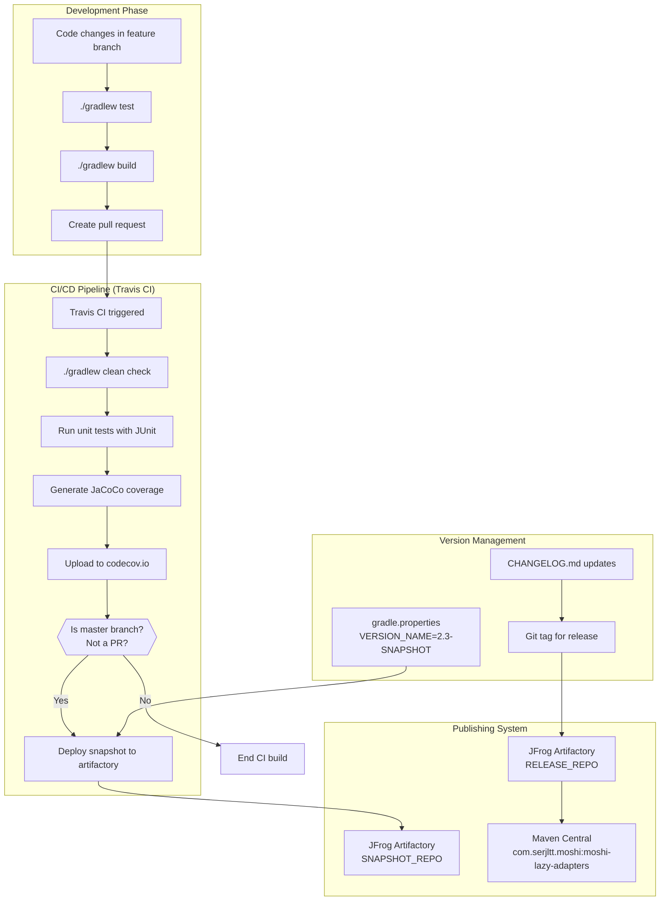

# Developer Guide

Relevant source files

The following files were used as context for generating this wiki page:

- [CHANGELOG.md](CHANGELOG.md)
- [LICENSE](LICENSE)
- [README.md](README.md)
- [gradle.properties](gradle.properties)

This guide provides technical documentation for developers who want to understand, modify, or contribute to the moshi-lazy-adapters library. It covers the internal architecture, development patterns, and contribution workflow.

For information about using the library as a consumer, see [User Guide](#2). For detailed documentation of individual adapters and their usage, see [Available Adapters](#2.2).

## Library Architecture Overview

The moshi-lazy-adapters library extends Moshi's JSON processing capabilities through a structured pattern of annotations, factories, and adapters. The following diagram shows how the library integrates with Moshi's core architecture using actual code entities:

```mermaid
graph TB
    subgraph "Moshi Core Framework"
        MoshiBuilder["Moshi.Builder"]
        MoshiInstance["Moshi"]
        JsonAdapterBase["JsonAdapter<T>"]
        JsonQualifierBase["JsonQualifier"]
        JsonAdapterFactory["JsonAdapter.Factory"]
    end
    
    subgraph "moshi-lazy-adapters Extension Points"
        WrappedAnnotation["@Wrapped"]
        FallbackAnnotation["@FallbackOnNull"]
        DeserializeOnlyAnnotation["@DeserializeOnly"]
        FirstElementAnnotation["@FirstElement"]
        LastElementAnnotation["@LastElement"]
        ElementAtAnnotation["@ElementAt"]
        SerializeNullsAnnotation["@SerializeNulls"]
        
        WrappedFactory["Wrapped.ADAPTER_FACTORY"]
        FallbackFactory["FallbackOnNull.ADAPTER_FACTORY"]
        DeserializeOnlyFactory["DeserializeOnly.ADAPTER_FACTORY"]
        FirstElementFactory["FirstElement.ADAPTER_FACTORY"]
        LastElementFactory["LastElement.ADAPTER_FACTORY"]
        ElementAtFactory["ElementAt.ADAPTER_FACTORY"]
        SerializeNullsFactory["SerializeNulls.ADAPTER_FACTORY"]
    end
    
    subgraph "Adapter Implementations"
        WrappedJsonAdapter["WrappedJsonAdapter"]
        FallbackOnNullJsonAdapter["FallbackOnNullJsonAdapter"]
        TransientJsonAdapter["TransientJsonAdapter"]
        FirstElementJsonAdapter["FirstElementJsonAdapter"]
        LastElementJsonAdapter["LastElementJsonAdapter"]
        ElementAtJsonAdapter["ElementAtJsonAdapter"]
        SerializeNullsJsonAdapter["SerializeNullsJsonAdapter"]
    end
    
    subgraph "Utility Classes"
        UtilClass["Util.kt"]
        PairClass["Pair.java"]
    end
    
    %% Extension relationships
    WrappedAnnotation -.-> JsonQualifierBase
    FallbackAnnotation -.-> JsonQualifierBase
    DeserializeOnlyAnnotation -.-> JsonQualifierBase
    FirstElementAnnotation -.-> JsonQualifierBase
    
    %% Factory relationships
    WrappedFactory -.-> JsonAdapterFactory
    FallbackFactory -.-> JsonAdapterFactory
    DeserializeOnlyFactory -.-> JsonAdapterFactory
    FirstElementFactory -.-> JsonAdapterFactory
    
    %% Factory creates Adapter relationships
    WrappedFactory --> WrappedJsonAdapter
    FallbackFactory --> FallbackOnNullJsonAdapter
    DeserializeOnlyFactory --> TransientJsonAdapter
    FirstElementFactory --> FirstElementJsonAdapter
    LastElementFactory --> LastElementJsonAdapter
    ElementAtFactory --> ElementAtJsonAdapter
    SerializeNullsFactory --> SerializeNullsJsonAdapter
    
    %% Adapter inheritance
    WrappedJsonAdapter -.-> JsonAdapterBase
    FallbackOnNullJsonAdapter -.-> JsonAdapterBase
    TransientJsonAdapter -.-> JsonAdapterBase
    FirstElementJsonAdapter -.-> JsonAdapterBase
    
    %% Utility usage
    UtilClass --> WrappedFactory
    UtilClass --> FallbackFactory
    PairClass --> UtilClass
    
    %% Integration points
    MoshiBuilder --> WrappedFactory
    MoshiBuilder --> FallbackFactory
    MoshiBuilder --> DeserializeOnlyFactory
    MoshiBuilder --> MoshiInstance
```

**Sources:** [README.md:21-26](), [README.md:53-58](), [gradle.properties:1-7]()

## Development Patterns

### Annotation-Factory-Adapter Pattern

Each feature in moshi-lazy-adapters follows a consistent three-layer pattern that enables modular extension of Moshi's capabilities:

**Sources:** [README.md:28-33](), [README.md:46-58]()

### Adapter Composition Chain

The library's key architectural feature is adapter composition, where multiple adapters can be chained together. The order of factory registration determines the execution order:

**Sources:** [README.md:34-58](), [README.md:102-107]()

## Development Workflow

### Project Structure and Key Files

The following table shows the essential files for library development:

| File Category | File Path | Purpose |
|---------------|-----------|---------|
| Library Metadata | `gradle.properties` | Version, artifact coordinates, licensing |
| Build Configuration | `build.gradle` | Dependencies, compilation, publishing |
| Dependencies | `dependencies.gradle` | Centralized dependency management |
| Source Code | `src/main/java/` | Annotation and adapter implementations |
| Tests | `src/test/java/` | Unit tests for adapter behavior |
| Documentation | `README.md`, `CHANGELOG.md` | User documentation and version history |

**Sources:** [gradle.properties:1-20](), [CHANGELOG.md:1-67]()

### Build and Release Process

The library uses a Gradle-based build system with automated CI/CD through Travis CI:

**Sources:** [gradle.properties:1-3](), [CHANGELOG.md:4-67]()

## Contribution Guidelines

### Adding New Adapters

To contribute a new adapter to the library, follow this established pattern:

1. **Create the annotation** - Implement a `@JsonQualifier` annotation with appropriate `@Target` and `@Retention` specifications
2. **Implement the factory** - Create a `JsonAdapter.Factory` with a public static `ADAPTER_FACTORY` constant
3. **Build the adapter** - Extend `JsonAdapter<T>` with custom `fromJson()` and `toJson()` logic
4. **Support composition** - Use `Util.nextAnnotations()` to enable chaining with other adapters
5. **Add comprehensive tests** - Create unit tests covering serialization, deserialization, and edge cases

### Code Quality Standards

The project maintains code quality through:

- **Checkstyle** enforcement for consistent code formatting
- **JaCoCo** code coverage reporting (target coverage levels enforced by CI)
- **Unit test requirements** for all new adapter functionality
- **Documentation standards** following existing patterns in README.md

**Sources:** [README.md:173-188](), [CHANGELOG.md:22-30](), [gradle.properties:14-16]()
