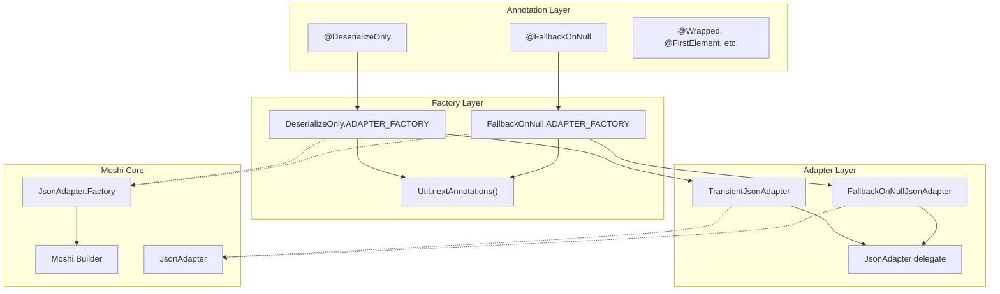
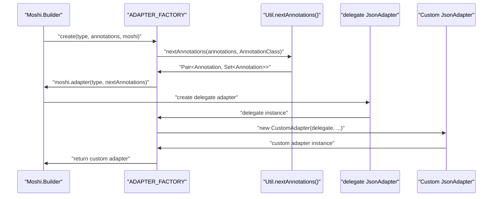
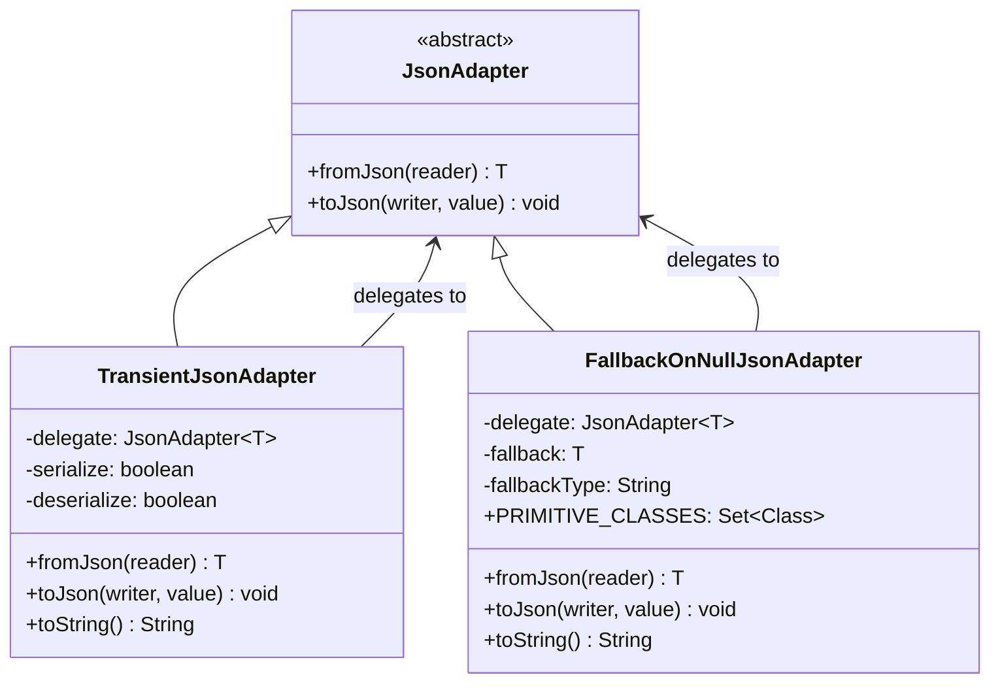
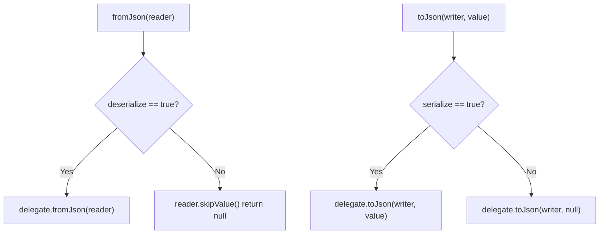
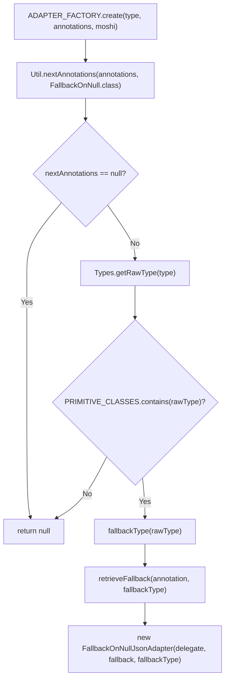
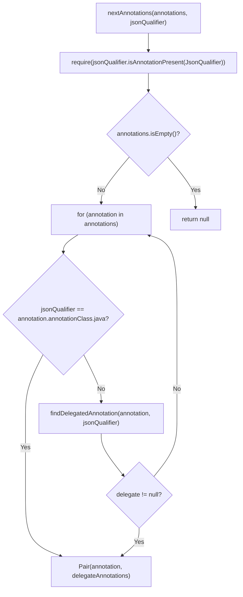

# Internal Architecture

Relevant source files

The following files were used as context for generating this wiki page:

- [src/main/java/com/serjltt/moshi/adapters/DeserializeOnly.kt](src/main/java/com/serjltt/moshi/adapters/DeserializeOnly.kt)
- [src/main/java/com/serjltt/moshi/adapters/FallbackOnNull.kt](src/main/java/com/serjltt/moshi/adapters/FallbackOnNull.kt)
- [src/main/java/com/serjltt/moshi/adapters/FallbackOnNullJsonAdapter.kt](src/main/java/com/serjltt/moshi/adapters/FallbackOnNullJsonAdapter.kt)
- [src/main/java/com/serjltt/moshi/adapters/TransientJsonAdapter.kt](src/main/java/com/serjltt/moshi/adapters/TransientJsonAdapter.kt)
- [src/main/java/com/serjltt/moshi/adapters/Util.kt](src/main/java/com/serjltt/moshi/adapters/Util.kt)

This document provides a deep dive into the internal architecture of the moshi-lazy-adapters library, covering the design patterns, utility classes, and adapter implementation details. It is intended for developers who want to understand, modify, or contribute to the library codebase.

For information about how to use these adapters, see [User Guide](#2). For build system details, see [Build System](#3.2).

## Core Architecture Pattern

The moshi-lazy-adapters library follows a three-layer architecture pattern where annotations are processed by factories to create specialized adapters:

### Architecture Flow Diagram

**Sources:** [src/main/java/com/serjltt/moshi/adapters/DeserializeOnly.kt:32-41](), [src/main/java/com/serjltt/moshi/adapters/FallbackOnNull.kt:68-83](), [src/main/java/com/serjltt/moshi/adapters/Util.kt:31-54]()

## Annotation Processing Chain

The library uses a consistent pattern for processing annotations through the `Util.nextAnnotations()` method:

### Annotation Processing Flow

The `nextAnnotations()` method extracts the target annotation and returns the remaining annotations for delegation:

| Method | Purpose | Return Value |
|--------|---------|--------------|
| `Util.nextAnnotations()` | Extracts target annotation from annotation set | `Pair<A, Set<Annotation>>` or `null` |
| Annotation validation | Ensures target class has `@JsonQualifier` | Throws `IllegalArgumentException` if invalid |
| Delegate annotation support | Finds annotations that delegate to target annotation | Returns delegated annotation if found |

**Sources:** [src/main/java/com/serjltt/moshi/adapters/Util.kt:31-54](), [src/main/java/com/serjltt/moshi/adapters/DeserializeOnly.kt:34-35](), [src/main/java/com/serjltt/moshi/adapters/FallbackOnNull.kt:74-75]()

## Adapter Implementation Pattern

All custom adapters follow a delegation pattern where they wrap a delegate `JsonAdapter` and modify its behavior:

### Adapter Delegation Architecture

### TransientJsonAdapter Implementation

The `TransientJsonAdapter` conditionally delegates based on `serialize` and `deserialize` flags:

**Sources:** [src/main/java/com/serjltt/moshi/adapters/TransientJsonAdapter.kt:18-35]()

## Factory Design Pattern

Each annotation provides a companion object with an `ADAPTER_FACTORY` that implements `JsonAdapter.Factory`:

### Factory Implementation Comparison

| Factory | Validation Logic | Adapter Creation |
|---------|-----------------|------------------|
| `DeserializeOnly.ADAPTER_FACTORY` | Uses `Types.nextAnnotations()` | Creates `TransientJsonAdapter(delegate, false, true)` |
| `FallbackOnNull.ADAPTER_FACTORY` | Uses `Util.nextAnnotations()` + primitive type check | Creates `FallbackOnNullJsonAdapter(delegate, fallback, fallbackType)` |

### FallbackOnNull Factory Logic

**Sources:** [src/main/java/com/serjltt/moshi/adapters/FallbackOnNull.kt:71-83](), [src/main/java/com/serjltt/moshi/adapters/DeserializeOnly.kt:33-40]()

## Utility Infrastructure

### Util.nextAnnotations() Implementation

The core utility method processes annotations using this algorithm:

### Primitive Type Support

The `FallbackOnNullJsonAdapter` maintains a static set of supported primitive types:

| Primitive Type | Kotlin Class | Default Fallback Value |
|----------------|--------------|-------------------------|
| `boolean` | `Boolean::class.javaPrimitiveType` | `false` |
| `byte` | `Byte::class.javaPrimitiveType` | `Byte.MIN_VALUE` |
| `char` | `Char::class.javaPrimitiveType` | `Character.MIN_VALUE` |
| `double` | `Double::class.javaPrimitiveType` | `Double.MIN_VALUE` |
| `float` | `Float::class.javaPrimitiveType` | `Float.MIN_VALUE` |
| `int` | `Int::class.javaPrimitiveType` | `Integer.MIN_VALUE` |
| `long` | `Long::class.javaPrimitiveType` | `Long.MIN_VALUE` |
| `short` | `Short::class.javaPrimitiveType` | `Short.MIN_VALUE` |

**Sources:** [src/main/java/com/serjltt/moshi/adapters/Util.kt:31-66](), [src/main/java/com/serjltt/moshi/adapters/FallbackOnNullJsonAdapter.kt:35-46](), [src/main/java/com/serjltt/moshi/adapters/FallbackOnNull.kt:49-66]()
