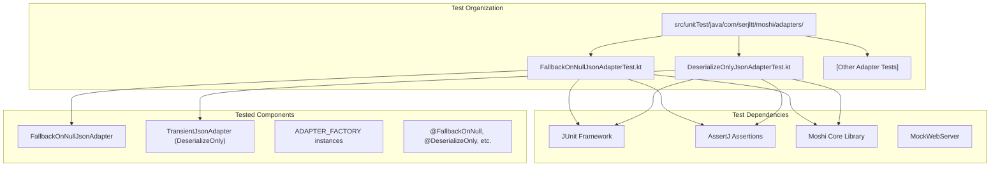
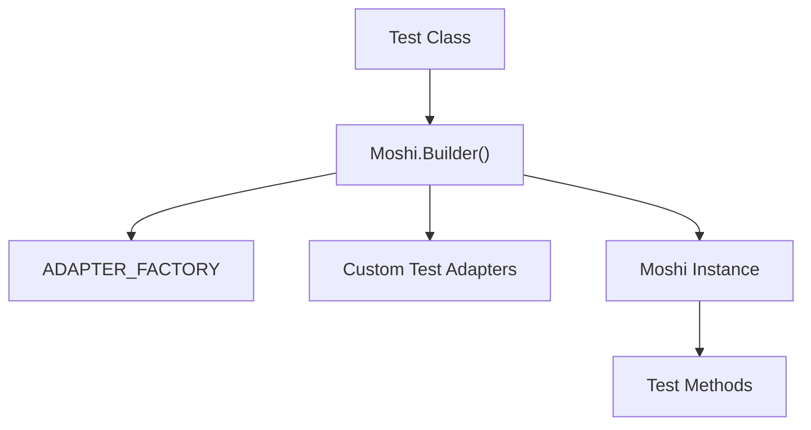
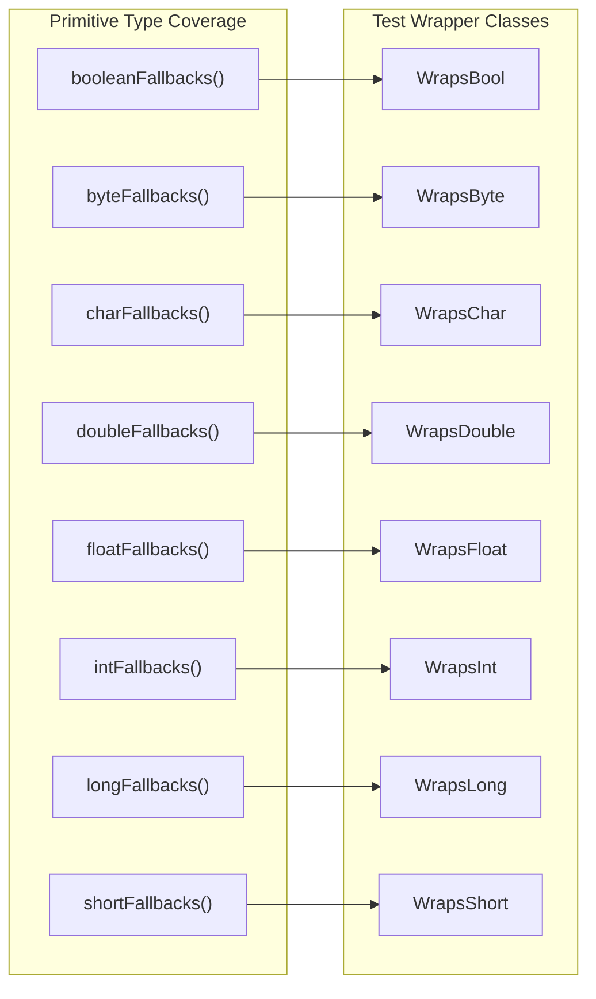
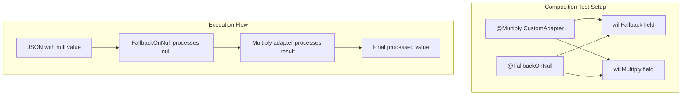
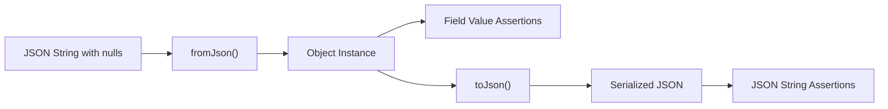
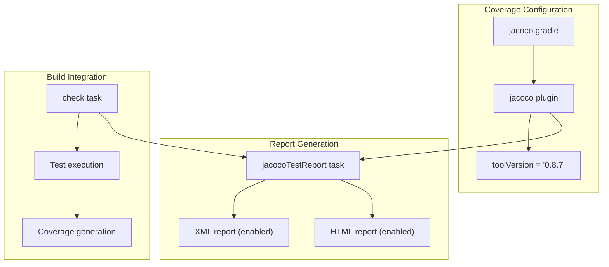

# Testing

Relevant source files

The following files were used as context for generating this wiki page:

- [jacoco.gradle](jacoco.gradle)
- [src/unitTest/java/com/serjltt/moshi/adapters/DeserializeOnlyJsonAdapterTest.kt](src/unitTest/java/com/serjltt/moshi/adapters/DeserializeOnlyJsonAdapterTest.kt)
- [src/unitTest/java/com/serjltt/moshi/adapters/FallbackOnNullJsonAdapterTest.kt](src/unitTest/java/com/serjltt/moshi/adapters/FallbackOnNullJsonAdapterTest.kt)

This document covers the testing infrastructure, patterns, and code coverage setup used in the moshi-lazy-adapters library. It describes how adapter functionality is validated through unit tests and how test coverage is measured and reported. For information about the build system configuration that executes these tests, see [Build System](#3.2). For details about code quality enforcement, see [Code Quality](#3.4).

## Test Structure and Organization

The library uses a comprehensive unit testing approach to validate adapter behavior. All tests are located in the `src/unitTest/java/com/serjltt/moshi/adapters/` directory and follow consistent patterns for testing JSON adapter functionality.

**Sources:** [src/unitTest/java/com/serjltt/moshi/adapters/FallbackOnNullJsonAdapterTest.kt:1-390](), [src/unitTest/java/com/serjltt/moshi/adapters/DeserializeOnlyJsonAdapterTest.kt:1-58]()

## Testing Patterns

### Moshi Builder Setup Pattern

Each test class follows a consistent pattern for setting up the `Moshi` instance with the necessary adapter factories:

The `FallbackOnNullJsonAdapterTest` class demonstrates this pattern by initializing Moshi with both the target adapter factory and additional test adapters for composition testing [src/unitTest/java/com/serjltt/moshi/adapters/FallbackOnNullJsonAdapterTest.kt:45-48]().

**Sources:** [src/unitTest/java/com/serjltt/moshi/adapters/FallbackOnNullJsonAdapterTest.kt:45-48](), [src/unitTest/java/com/serjltt/moshi/adapters/DeserializeOnlyJsonAdapterTest.kt:17-20]()

### Primitive Type Testing Pattern

The `FallbackOnNullJsonAdapter` tests cover all primitive types using a systematic approach. Each primitive type has dedicated test wrapper classes and verification methods:

Each wrapper class contains two fields: one with default fallback behavior and another with custom fallback values [src/unitTest/java/com/serjltt/moshi/adapters/FallbackOnNullJsonAdapterTest.kt:56-69]().

**Sources:** [src/unitTest/java/com/serjltt/moshi/adapters/FallbackOnNullJsonAdapterTest.kt:50-258]()

### Adapter Composition Testing

Tests verify that multiple adapters work correctly together by using custom test adapters alongside the library adapters:

The `factoryMaintainsOtherAnnotations()` test method validates that adapter composition preserves the functionality of other annotations [src/unitTest/java/com/serjltt/moshi/adapters/FallbackOnNullJsonAdapterTest.kt:262-275]().

**Sources:** [src/unitTest/java/com/serjltt/moshi/adapters/FallbackOnNullJsonAdapterTest.kt:262-275](), [src/unitTest/java/com/serjltt/moshi/adapters/FallbackOnNullJsonAdapterTest.kt:277-285]()

## Test Assertion Patterns

### Bidirectional JSON Testing

Tests verify both deserialization (JSON to object) and serialization (object to JSON) behavior using a common assertion pattern:

The `assertForClass()` helper method implements this pattern, testing both directions of JSON conversion [src/unitTest/java/com/serjltt/moshi/adapters/FallbackOnNullJsonAdapterTest.kt:346-362]().

**Sources:** [src/unitTest/java/com/serjltt/moshi/adapters/FallbackOnNullJsonAdapterTest.kt:346-362]()

### Factory Behavior Validation

Tests include specific validation for adapter factory behavior, ensuring factories correctly identify applicable types and ignore non-applicable ones:

The `factoryIgnoresNonPrimitiveTypes()` test validates that `FallbackOnNull.ADAPTER_FACTORY` returns `null` for non-primitive types, following the Moshi adapter factory contract [src/unitTest/java/com/serjltt/moshi/adapters/FallbackOnNullJsonAdapterTest.kt:288-307]().

**Sources:** [src/unitTest/java/com/serjltt/moshi/adapters/FallbackOnNullJsonAdapterTest.kt:288-307]()

## Code Coverage Configuration

The library uses JaCoCo for code coverage measurement and reporting. The coverage configuration is defined in a separate Gradle file:

The configuration enables both XML and HTML report formats, with XML reports typically used for CI/CD integration and HTML reports for local development review [jacoco.gradle:7-12]().

**Sources:** [jacoco.gradle:1-15]()

## Test Execution Integration

### Build System Integration

Tests are integrated into the Gradle build lifecycle through task dependencies:

- The `check` task depends on `jacocoTestReport` [jacoco.gradle:14]()
- Coverage reports are generated after test execution
- CI/CD pipeline executes tests through `./gradlew clean check`

### Locale Independence Testing

The test suite includes specific validation for locale-independent behavior, ensuring adapter functionality works correctly across different system locales [src/unitTest/java/com/serjltt/moshi/adapters/FallbackOnNullJsonAdapterTest.kt:184-195]().

**Sources:** [jacoco.gradle:14](), [src/unitTest/java/com/serjltt/moshi/adapters/FallbackOnNullJsonAdapterTest.kt:184-195]()
