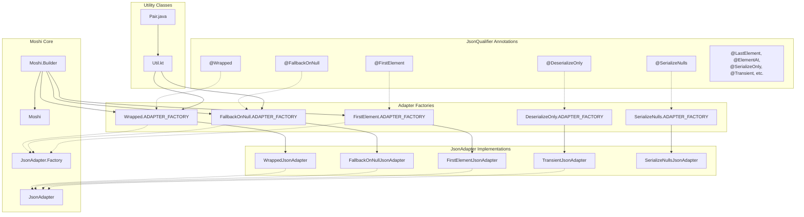
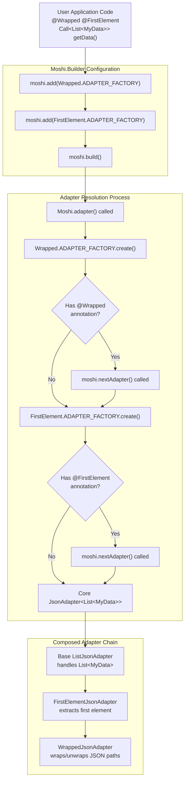

# Overview

<details>
<summary>Relevant source files</summary>

The following files were used as context for generating this wiki page:

- [CHANGELOG.md](CHANGELOG.md)
- [LICENSE](LICENSE)
- [README.md](README.md)
- [gradle.properties](gradle.properties)

</details>


## Purpose and Scope

This document provides a high-level introduction to the `moshi-lazy-adapters` library, covering its architecture, core components, and integration patterns. It explains the library's role as an extension to Square's Moshi JSON library and how its adapter composition system works.

For detailed usage examples and integration instructions, see [User Guide](#2). For internal implementation details and development information, see [Developer Guide](#3).

## What is moshi-lazy-adapters

The `moshi-lazy-adapters` library is a collection of specialized `JsonAdapter` implementations that extend the capabilities of Square's Moshi JSON library. Rather than being a replacement for Moshi, it acts as a plugin system that provides additional serialization and deserialization strategies through `JsonQualifier` annotations.

The library addresses common JSON processing challenges such as:
- Unwrapping nested JSON structures with `@Wrapped`
- Handling null values for primitives with `@FallbackOnNull` 
- Extracting specific elements from arrays with `@FirstElement`, `@LastElement`, `@ElementAt`
- Controlling serialization behavior with `@DeserializeOnly`, `@SerializeOnly`

Unlike other JSON adapter libraries, moshi-lazy-adapters is designed around **adapter composition**, allowing multiple adapters to be chained together to handle complex transformation scenarios.

**Sources:** [README.md:10-14](), [gradle.properties:4]()

## Core Architecture

The library follows a three-layer architecture built on Moshi's extension points:

### Component Architecture



**Sources:** [README.md:18-26](), [README.md:157-171]()

## Adapter Composition System

The library's key innovation is its **adapter composition** mechanism, where multiple `JsonAdapter.Factory` instances can be chained together without interfering with each other. This differs from traditional adapter patterns where each factory might short-circuit the creation process.

### Composition Flow



### Critical Ordering Requirement

The order of factory registration in `Moshi.Builder` determines the adapter chain execution order, **not** the order of annotations on the target type. This means:

```java
// Factory order determines execution sequence
Moshi moshi = new Moshi.Builder()
  .add(Wrapped.ADAPTER_FACTORY)         // Executes first (outermost)
  .add(FirstElement.ADAPTER_FACTORY)    // Executes second
  .build();
```

**Sources:** [README.md:46-58](), [README.md:28-44]()

## Available Adapter Categories

The library provides adapters in several functional categories:

| Category | Adapters | Purpose |
|----------|----------|---------|
| **JSON Structure** | `@Wrapped` | Navigate nested JSON paths |
| **Null Handling** | `@FallbackOnNull`, `@FallbackEnum` | Provide defaults for null values |
| **Array Processing** | `@FirstElement`, `@LastElement`, `@ElementAt` | Extract specific array elements |
| **Serialization Control** | `@SerializeOnly`, `@DeserializeOnly`, `@Transient` | Control field serialization direction |
| **Collection Filtering** | `@SerializeOnlyNonEmpty` | Skip empty collections |
| **Value Processing** | `DefaultOnDataMismatchAdapter` | Handle type mismatches |

**Sources:** [README.md:157-171]()

## Integration Approach

The library follows a **non-invasive** integration model - it does not force any adapters by default. Each adapter must be explicitly registered with the `Moshi.Builder`:

```java
Moshi moshi = new Moshi.Builder()
  .add(Wrapped.ADAPTER_FACTORY)
  .add(FallbackOnNull.ADAPTER_FACTORY)
  .add(FirstElement.ADAPTER_FACTORY)
  .build();
```

This design allows applications to selectively enable only the adapters they need, minimizing runtime overhead and potential conflicts.

**Sources:** [README.md:16-26]()

## Library Metadata

| Property | Value |
|----------|-------|
| **Group ID** | `com.serjltt.moshi` |
| **Artifact ID** | `moshi-lazy-adapters` |
| **Current Version** | `2.3-SNAPSHOT` |
| **License** | Apache License 2.0 |
| **Repository** | `https://github.com/serj-lotutovici/moshi-lazy-adapters` |

**Sources:** [gradle.properties:1-2](), [gradle.properties:4-5](), [gradle.properties:9](), [gradle.properties:14]()
