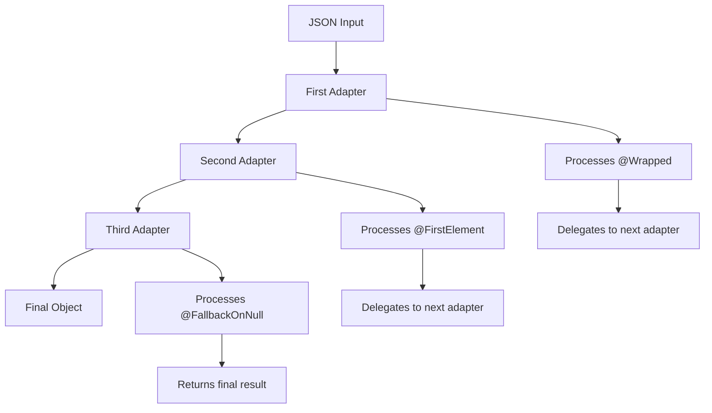
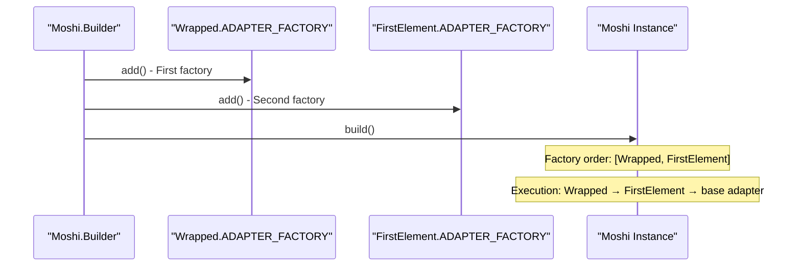
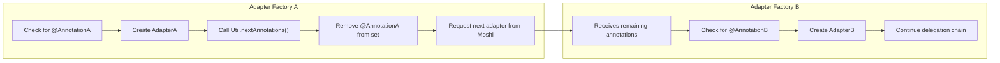
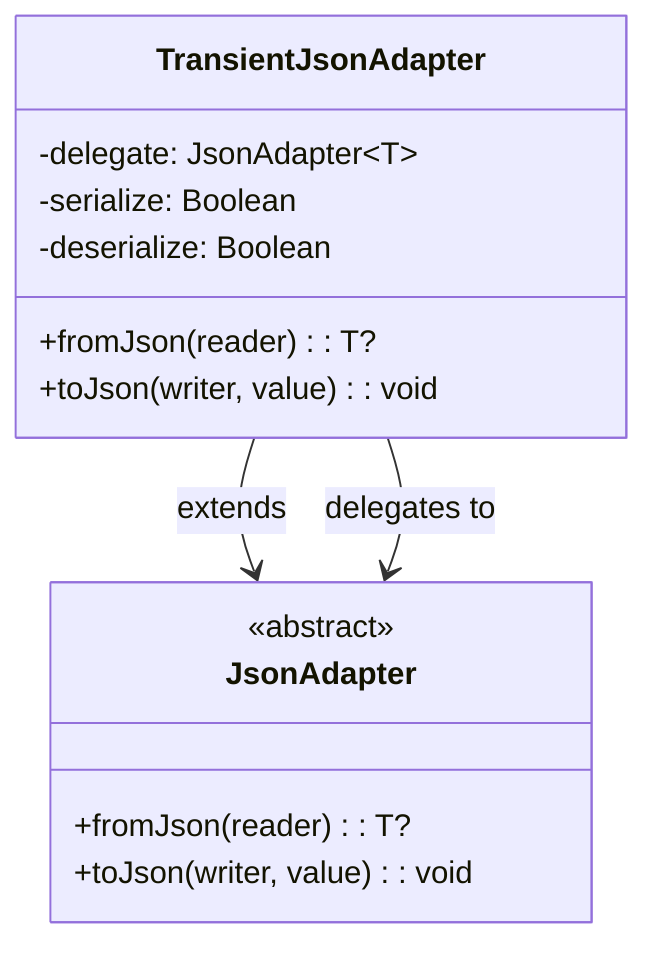

# Adapter Composition

<details>
<summary>Relevant source files</summary>

The following files were used as context for generating this wiki page:

- [CHANGELOG.md](CHANGELOG.md)
- [LICENSE](LICENSE)
- [README.md](README.md)
- [gradle.properties](gradle.properties)
- [src/main/java/com/serjltt/moshi/adapters/TransientJsonAdapter.kt](src/main/java/com/serjltt/moshi/adapters/TransientJsonAdapter.kt)
- [src/main/java/com/serjltt/moshi/adapters/Util.kt](src/main/java/com/serjltt/moshi/adapters/Util.kt)

</details>


This document explains how multiple moshi-lazy-adapters can work together in a chain to process JSON data through multiple transformation steps. It covers the delegation pattern, factory registration order, and how annotations compose to create complex adapter behavior.

For information about individual adapter functionality, see [Available Adapters](#2.2). For library integration basics, see [Integration](#2.1).

## Core Concept

Adapter composition in moshi-lazy-adapters allows multiple JsonAdapter instances to work together in a chain, where each adapter performs its specific transformation and delegates to the next adapter in the sequence. This enables complex JSON processing scenarios where data needs multiple transformations.

The library implements a **non-short-circuiting** approach where each `JsonAdapter.Factory` processes its annotation and then delegates to the next available adapter from Moshi rather than terminating the chain. This means multiple annotations can be applied to the same field or method, and all will be processed in the order determined by factory registration.



**Sources:** [README.md:28-60]()

## Factory Registration Order

The order of `JsonAdapter.Factory` registration in the `Moshi.Builder` determines the execution order of adapters, **not** the order of annotations in the code. This is a critical concept for achieving expected behavior with composed adapters.

### Registration Order vs Annotation Order

| Concept | Determines | Example |
|---------|------------|---------|
| Factory Registration Order | Execution sequence of adapters | `builder.add(Wrapped.ADAPTER_FACTORY).add(FirstElement.ADAPTER_FACTORY)` |
| Annotation Declaration Order | **No impact** on execution | `@Wrapped @FirstElement` vs `@FirstElement @Wrapped` |



### Correct Factory Registration

For an annotation combination like `@Wrapped(path={"result", "data"}) @FirstElement`, the factories must be registered in the desired processing order:

```java
Moshi moshi = new Moshi.Builder()
  .add(Wrapped.ADAPTER_FACTORY)      // Processes first
  .add(FirstElement.ADAPTER_FACTORY) // Processes second  
  .build();
```

**Sources:** [README.md:46-58]()

## Delegation Chain Implementation

The delegation mechanism is implemented through the `Util.nextAnnotations()` function, which removes the current adapter's annotation from the set and passes the remaining annotations to the next adapter in the chain.



### nextAnnotations Function

The `Util.nextAnnotations()` function is the core mechanism enabling composition:

- Takes the current annotation set and target annotation class
- Returns a `Pair` containing the found annotation and remaining annotations
- Enables each factory to process only its annotation while preserving others

**Sources:** [src/main/java/com/serjltt/moshi/adapters/Util.kt:31-54]()

## Practical Composition Examples

### Wrapped + FirstElement

This combination unwraps nested JSON and extracts the first element from an array:

```mermaid
flowchart TD
    JSON["JSON Response<br/>{\"result\": {\"data\": [item1, item2, item3]}}"] --> WA["WrappedJsonAdapter"]
    WA --> Extract["Extracts: [item1, item2, item3]"]
    Extract --> FEA["FirstElementJsonAdapter"] 
    FEA --> Final["Returns: item1"]
    
    WA --> WProcess["Processes @Wrapped<br/>path={\"result\", \"data\"}"]
    FEA --> FProcess["Processes @FirstElement"]
```

### DeserializeOnly + FallbackOnNull

This combination ignores serialization and provides null fallbacks during deserialization:

```mermaid
graph TD
    Input["JSON: {\"field\": null}"] --> DOA["DeserializeOnly adapter"]
    DOA --> Process["Deserialize only, skip serialize"]
    Process --> FOA["FallbackOnNull adapter"]  
    FOA --> Fallback["Apply fallback value for null"]
    Fallback --> Result["Final deserialized object"]
    
    SerializeAttempt["Serialize attempt"] --> DOA
    DOA --> Skip["Skip serialization"]
```

**Sources:** [README.md:33-44]()

## TransientJsonAdapter Implementation

The `TransientJsonAdapter` class demonstrates the delegation pattern used throughout the library. It wraps a delegate adapter and controls serialization/deserialization behavior based on configuration flags.



### Delegation Logic

- **Deserialization**: If `deserialize=true`, delegates to the wrapped adapter; otherwise skips the value
- **Serialization**: If `serialize=true`, delegates to the wrapped adapter; otherwise writes null
- **String representation**: Reflects the transient behavior in the `toString()` method

**Sources:** [src/main/java/com/serjltt/moshi/adapters/TransientJsonAdapter.kt:12-40]()

## Composition Benefits

| Benefit | Description | Example Use Case |
|---------|-------------|------------------|
| **Modularity** | Each adapter has a single responsibility | Separate concerns for unwrapping vs element extraction |
| **Reusability** | Adapters can be combined in different ways | Use `@FallbackOnNull` with various other adapters |
| **Maintainability** | Changes to one adapter don't affect others | Modify wrapping logic without touching element extraction |
| **Flexibility** | Dynamic composition based on factory registration order | Different processing orders for different endpoints |

**Sources:** [README.md:28-60]()
