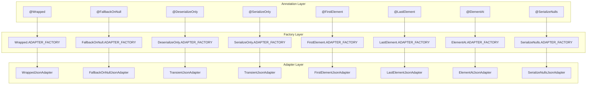
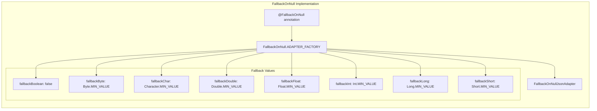

# Available Adapters

<details>
<summary>Relevant source files</summary>

The following files were used as context for generating this wiki page:

- [CHANGELOG.md](CHANGELOG.md)
- [LICENSE](LICENSE)
- [README.md](README.md)
- [gradle.properties](gradle.properties)
- [src/main/java/com/serjltt/moshi/adapters/DeserializeOnly.kt](src/main/java/com/serjltt/moshi/adapters/DeserializeOnly.kt)
- [src/main/java/com/serjltt/moshi/adapters/FallbackOnNull.kt](src/main/java/com/serjltt/moshi/adapters/FallbackOnNull.kt)
- [src/main/java/com/serjltt/moshi/adapters/FallbackOnNullJsonAdapter.kt](src/main/java/com/serjltt/moshi/adapters/FallbackOnNullJsonAdapter.kt)

</details>


This page provides comprehensive documentation of all JsonQualifier annotations and their corresponding adapters provided by the moshi-lazy-adapters library. Each adapter modifies JSON serialization or deserialization behavior when applied to fields, properties, or method parameters.

For information about integrating these adapters into your project, see [Integration](#2.1). For details about how multiple adapters work together, see [Adapter Composition](#2.3).

## Adapter Architecture Overview

The library follows a consistent pattern where each `@JsonQualifier` annotation is paired with an `ADAPTER_FACTORY` that creates the appropriate `JsonAdapter` implementation.



Sources: [README.md:157-172](), [src/main/java/com/serjltt/moshi/adapters/DeserializeOnly.kt:32-41](), [src/main/java/com/serjltt/moshi/adapters/FallbackOnNull.kt:68-102]()

## Core Adapter Types

### Data Extraction Adapters

These adapters modify how data is extracted from JSON structures during deserialization.

#### @Wrapped

Unwraps nested JSON objects by following a specified path, eliminating the need for intermediate wrapper classes.

| Property | Description |
|----------|-------------|
| `path` | Array of string keys defining the path to the target value |
| Factory | `Wrapped.ADAPTER_FACTORY` |
| Adapter | `WrappedJsonAdapter` |

**Usage Example:**
```java
// JSON: {"favorite_pokemon": {"pokemons": ["Snorlax", "Pikachu"]}}
interface PokemonService {
  @GET("/pokemon/favorite")  
  @Wrapped({"favorite_pokemon", "pokemons"}) 
  Call<List<String>> getFavorite();
}
```

**Adapter Behavior:**
- **Deserialization**: Navigates the JSON path and deserializes only the target value
- **Serialization**: Wraps the value in the specified JSON structure

Sources: [README.md:64-111]()

#### @FirstElement

Extracts only the first element from a JSON array during deserialization.

| Property | Description |
|----------|-------------|
| Factory | `FirstElement.ADAPTER_FACTORY` |
| Adapter | `FirstElementJsonAdapter` |

**Usage Example:**
```java
// JSON: ["primary_value", "secondary_value", "tertiary_value"]
@FirstElement
String primaryValue;
```

Sources: [README.md:162]()

#### @LastElement  

Extracts only the last element from a JSON array during deserialization.

| Property | Description |
|----------|-------------|
| Factory | `LastElement.ADAPTER_FACTORY` |
| Adapter | `LastElementJsonAdapter` |

Sources: [README.md:163]()

#### @ElementAt

Extracts an element from a specified position in a JSON array during deserialization.

| Property | Description |
|----------|-------------|
| `index` | Zero-based index of the element to extract |
| Factory | `ElementAt.ADAPTER_FACTORY` |
| Adapter | `ElementAtJsonAdapter` |

Sources: [README.md:164]()

### Null Handling Adapters

These adapters provide various strategies for handling `null` values in JSON.

#### @FallbackOnNull

Provides default values for primitive fields when the JSON contains `null` values, avoiding the need for boxed types.



**Configuration Options:**

| Primitive Type | Default Fallback | Configuration Parameter |
|----------------|------------------|-------------------------|
| `boolean` | `false` | `fallbackBoolean` |
| `byte` | `Byte.MIN_VALUE` | `fallbackByte` |
| `char` | `Character.MIN_VALUE` | `fallbackChar` |
| `double` | `Double.MIN_VALUE` | `fallbackDouble` |
| `float` | `Float.MIN_VALUE` | `fallbackFloat` |
| `int` | `Int.MIN_VALUE` | `fallbackInt` |
| `long` | `Long.MIN_VALUE` | `fallbackLong` |
| `short` | `Short.MIN_VALUE` | `fallbackShort` |

**Usage Example:**
```java
class Pokemon {
  String name;
  @FallbackOnNull int number_of_wins;           // Uses Int.MIN_VALUE
  @FallbackOnNull(fallbackInt = -1) int losses; // Uses custom fallback
}
```

**Implementation Details:**
- Factory: [src/main/java/com/serjltt/moshi/adapters/FallbackOnNull.kt:70-102]()
- Adapter: [src/main/java/com/serjltt/moshi/adapters/FallbackOnNullJsonAdapter.kt:28-66]()
- Supported primitives: [src/main/java/com/serjltt/moshi/adapters/FallbackOnNullJsonAdapter.kt:35-46]()

Sources: [README.md:113-154](), [src/main/java/com/serjltt/moshi/adapters/FallbackOnNull.kt:49-66](), [src/main/java/com/serjltt/moshi/adapters/FallbackOnNullJsonAdapter.kt:49-61]()

#### @FallbackEnum

Provides a default enum value when the JSON contains a value that cannot be matched to an existing enum constant.

| Property | Description |
|----------|-------------|
| `fallback` | The enum constant to use as fallback |
| Factory | `FallbackEnum.ADAPTER_FACTORY` |
| Adapter | `FallbackEnumJsonAdapter` |

Sources: [README.md:166]()

### Serialization Control Adapters

These adapters control which fields are included during serialization and deserialization.

#### @DeserializeOnly

Marks fields that should only be processed during deserialization and ignored during serialization.

**Implementation:**
```kotlin
val ADAPTER_FACTORY = JsonAdapter.Factory { type, annotations, moshi ->
  val nextAnnotations = Types.nextAnnotations(annotations, DeserializeOnly::class.java)
    ?: return@Factory null
  TransientJsonAdapter(moshi.adapter<Any>(type, nextAnnotations),
    serialize = false,
    deserialize = true
  )
}
```

**Usage Example:**
```java
class User {
  String name;
  @DeserializeOnly String serverGeneratedId; // Only read from JSON
}
```

Sources: [src/main/java/com/serjltt/moshi/adapters/DeserializeOnly.kt:8-41](), [README.md:169]()

#### @SerializeOnly

Marks fields that should only be processed during serialization and ignored during deserialization.

| Property | Description |
|----------|-------------|
| Factory | `SerializeOnly.ADAPTER_FACTORY` |  
| Adapter | `TransientJsonAdapter` with `serialize = true, deserialize = false` |

Sources: [README.md:168]()

#### @Transient

Indicates that a field should be completely ignored for both serialization and deserialization.

| Property | Description |
|----------|-------------|
| Target | Methods only |
| Factory | `Transient.ADAPTER_FACTORY` |
| Adapter | `TransientJsonAdapter` |

Sources: [README.md:170]()

#### @SerializeNulls

Forces serialization of fields even when their values are `null`, overriding Moshi's default behavior.

| Property | Description |
|----------|-------------|
| Factory | `SerializeNulls.ADAPTER_FACTORY` |
| Adapter | `SerializeNullsJsonAdapter` |

Sources: [README.md:161]()

#### @SerializeOnlyNonEmpty

Serializes collections and arrays only when they contain at least one element.

| Property | Description |
|----------|-------------|  
| Target | Collections and arrays |
| Factory | `SerializeOnlyNonEmpty.ADAPTER_FACTORY` |
| Adapter | `SerializeOnlyNonEmptyJsonAdapter` |

Sources: [README.md:171]()

### Utility Adapters

#### DefaultOnDataMismatchAdapter

Provides fallback values for any type when data parsing fails due to type mismatches.

| Property | Description |
|----------|-------------|
| Purpose | Handle data type mismatches gracefully |
| Usage | Generic fallback mechanism |

Sources: [README.md:160](), [CHANGELOG.md:16]()

## Adapter Factory Integration Pattern

Each adapter follows the same integration pattern with `Moshi.Builder`:

```java
Moshi moshi = new Moshi.Builder()
  .add(Wrapped.ADAPTER_FACTORY)
  .add(FallbackOnNull.ADAPTER_FACTORY) 
  .add(DeserializeOnly.ADAPTER_FACTORY)
  .add(FirstElement.ADAPTER_FACTORY)
  // Order matters for adapter composition
  .build();
```

The factory order determines adapter chaining behavior as described in [Adapter Composition](#2.3).

Sources: [README.md:21-26](), [README.md:52-58]()
