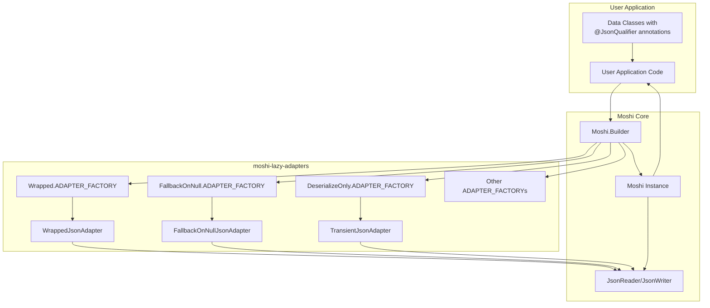
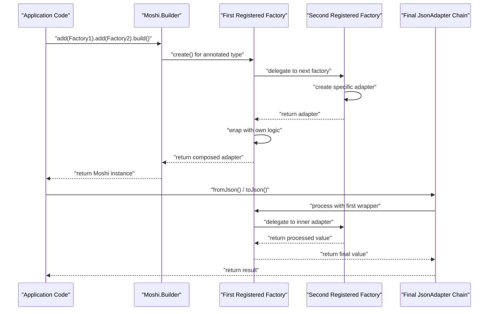
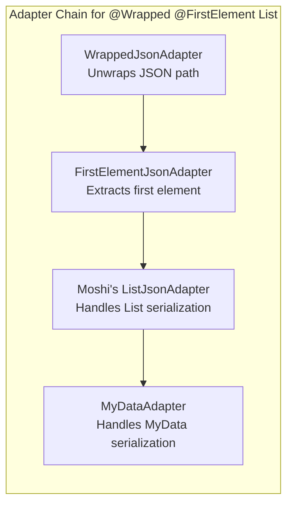

# Integration

<details>
<summary>Relevant source files</summary>

The following files were used as context for generating this wiki page:

- [CHANGELOG.md](CHANGELOG.md)
- [LICENSE](LICENSE)
- [README.md](README.md)
- [dependencies.gradle](dependencies.gradle)
- [gradle.properties](gradle.properties)

</details>


This document covers how to add the moshi-lazy-adapters library to your project and perform basic setup with `Moshi.Builder`. It explains the fundamental integration pattern used by all adapters in this library. For detailed information about individual adapters and their usage, see [Available Adapters](#2.2). For understanding how multiple adapters work together, see [Adapter Composition](#2.3).

## Overview

The moshi-lazy-adapters library extends Moshi by providing specialized `JsonAdapter` implementations through `JsonQualifier` annotations. Unlike some Moshi extensions, this library does not automatically register any adapters - you must explicitly add the desired adapter factories to your `Moshi.Builder` instance.

## Adding the Dependency

The library is published to Maven Central under the coordinates specified in [gradle.properties:1-7](). Add it to your project using Maven or Gradle:

**Maven:**
```xml
<dependency>
  <groupId>com.serjltt.moshi</groupId>
  <artifactId>moshi-lazy-adapters</artifactId>
  <version>2.3-SNAPSHOT</version>
</dependency>
```

**Gradle:**
```gradle
implementation 'com.serjltt.moshi:moshi-lazy-adapters:2.3-SNAPSHOT'
```

The library requires Moshi 1.13.0 or higher as specified in [dependencies.gradle:7]().

Sources: [gradle.properties:1-7](), [dependencies.gradle:7](), [README.md:176-187]()

## Basic Integration Pattern

### Adapter Factory Registration

Each adapter in this library is accessed through its corresponding `ADAPTER_FACTORY` constant. The basic integration pattern involves adding these factories to your `Moshi.Builder`:

```java
Moshi moshi = new Moshi.Builder()
  .add(Wrapped.ADAPTER_FACTORY)
  .add(FallbackOnNull.ADAPTER_FACTORY)
  .build();
```

### Integration Architecture



Sources: [README.md:16-26](), [README.md:52-58]()

### Adapter Factory to Implementation Mapping

The library follows a consistent naming pattern where each annotation has a corresponding `ADAPTER_FACTORY` and `JsonAdapter` implementation:

| Annotation | Factory Constant | Adapter Implementation |
|------------|------------------|------------------------|
| `@Wrapped` | `Wrapped.ADAPTER_FACTORY` | `WrappedJsonAdapter` |
| `@FallbackOnNull` | `FallbackOnNull.ADAPTER_FACTORY` | `FallbackOnNullJsonAdapter` |
| `@DeserializeOnly` | `DeserializeOnly.ADAPTER_FACTORY` | `TransientJsonAdapter` |
| `@SerializeOnly` | `SerializeOnly.ADAPTER_FACTORY` | `TransientJsonAdapter` |
| `@FirstElement` | `FirstElement.ADAPTER_FACTORY` | `FirstElementJsonAdapter` |
| `@LastElement` | `LastElement.ADAPTER_FACTORY` | `LastElementJsonAdapter` |

Sources: [README.md:157-172](), [CHANGELOG.md:15-25]()

## Factory Registration Order

The order in which you add adapter factories to `Moshi.Builder` determines the execution order of adapter processing. This is crucial when using multiple annotations on the same field or type.

### Execution Flow Diagram



The example from [README.md:36-58]() demonstrates this concept:

```java
// To process @Wrapped(path={"result", "data"}) @FirstElement MyData getData()
// The factories must be registered in this specific order:
Moshi moshi = new Moshi.Builder()
  .add(Wrapped.ADAPTER_FACTORY)        // Processes @Wrapped first
  .add(FirstElement.ADAPTER_FACTORY)   // Then processes @FirstElement
  .build();
```

Sources: [README.md:28-58]()

## Adapter Composition Contract

All adapters in this library support composition, meaning they do not short-circuit the adapter creation process. Each `JsonAdapter.Factory` delegates to the next available adapter returned by Moshi, allowing multiple annotations to work together on the same field or type.



This composition contract ensures that the library integrates seamlessly with existing Moshi functionality and other custom adapters.

Sources: [README.md:28-44]()

## Verification

To verify your integration is working correctly, ensure that:

1. Your `Moshi` instance is created with the required adapter factories
2. Your data classes use the appropriate `JsonQualifier` annotations
3. The adapter factory registration order matches your intended processing sequence

A basic integration test pattern:

```java
// Example setup verification
Moshi moshi = new Moshi.Builder()
  .add(Wrapped.ADAPTER_FACTORY)
  .build();

JsonAdapter<MyType> adapter = moshi.adapter(MyType.class);
// adapter should now handle @Wrapped annotations on MyType
```

Sources: [README.md:16-26]()
