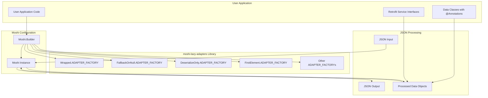
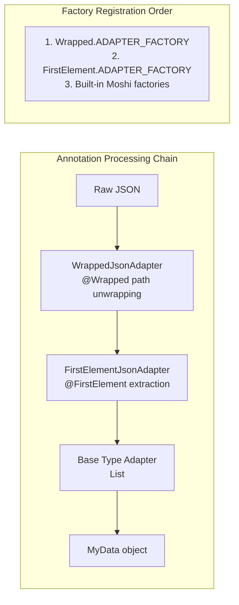

# User Guide

<details>
<summary>Relevant source files</summary>

The following files were used as context for generating this wiki page:

- [CHANGELOG.md](CHANGELOG.md)
- [LICENSE](LICENSE)
- [README.md](README.md)
- [gradle.properties](gradle.properties)

</details>


This document provides comprehensive guidance for developers who want to use the moshi-lazy-adapters library in their projects. It covers setup, available adapters, and best practices for leveraging the library's JsonQualifier annotations and adapter factories.

For detailed integration instructions, see [Integration](#2.1). For complete adapter documentation with examples, see [Available Adapters](#2.2). For understanding how multiple adapters work together, see [Adapter Composition](#2.3).

## Library Overview

The moshi-lazy-adapters library extends [Moshi](https://github.com/square/moshi) by providing a collection of specialized `JsonAdapter` implementations accessed through `JsonQualifier` annotations. Unlike standard Moshi adapters, this library follows a **non-intrusive** approach - no adapters are automatically registered. You explicitly add only the adapter factories your application needs.

### Core Architecture



Sources: [README.md:21-26](), [README.md:52-58]()

### Adapter Composition Pattern

The library's key strength lies in **adapter composition** - multiple annotations can be combined on a single field or type, with each adapter delegating to the next in the chain. The order of `JsonAdapter.Factory` registration in `Moshi.Builder` determines the processing sequence, not the annotation order.



Sources: [README.md:34-50](), [README.md:46-50]()

## Quick Start Example

Here's a minimal example showing how to integrate and use the library:

### Basic Setup

```java
// 1. Add desired adapter factories to Moshi.Builder
Moshi moshi = new Moshi.Builder()
    .add(Wrapped.ADAPTER_FACTORY)
    .add(FallbackOnNull.ADAPTER_FACTORY)
    .add(DeserializeOnly.ADAPTER_FACTORY)
    .build();

// 2. Use annotations on your data classes
public class ApiResponse {
    @Wrapped({"result", "data"}) 
    List<UserData> users;
    
    @FallbackOnNull(fallbackInt = -1)
    int totalCount;
    
    @DeserializeOnly
    String debugInfo;
}
```

Sources: [README.md:21-26](), [README.md:52-58]()

### Retrofit Integration

The library integrates seamlessly with Retrofit service interfaces:

```java
interface UserService {
    @GET("/api/users")
    @Wrapped({"response", "users"}) 
    @FirstElement 
    Call<User> getFirstUser();
    
    @GET("/api/stats") 
    Call<StatsResponse> getStats();
}
```

Sources: [README.md:36-40](), [README.md:102-107]()

## Available Adapter Categories

The library provides adapters in several functional categories:

| Category | Adapters | Purpose |
|----------|----------|---------|
| **JSON Navigation** | `@Wrapped` | Navigate nested JSON structures |
| **Array Processing** | `@FirstElement`, `@LastElement`, `@ElementAt` | Extract specific elements from arrays |
| **Null Handling** | `@FallbackOnNull`, `@FallbackEnum` | Provide defaults for null values |
| **Serialization Control** | `@SerializeOnly`, `@DeserializeOnly`, `@SerializeNulls` | Control when fields are processed |
| **Data Filtering** | `@SerializeOnlyNonEmpty`, `@Transient` | Filter or exclude data during processing |
| **Error Recovery** | `@DefaultOnDataMismatchAdapter` | Handle type mismatches gracefully |

Sources: [README.md:160-172]()

## Common Usage Patterns

### Pattern 1: Unwrapping Nested API Responses

Many APIs wrap useful data in nested objects. Use `@Wrapped` to extract the data directly:

```json
{
  "status": "success",
  "result": {
    "user_data": {
      "name": "John Doe",
      "email": "john@example.com"
    }
  }
}
```

```java
// Instead of creating wrapper classes, use @Wrapped
@Wrapped({"result", "user_data"})
User user;
```

Sources: [README.md:64-111]()

### Pattern 2: Robust Primitive Handling

Handle APIs that sometimes return `null` for primitive fields:

```java
public class GameStats {
    String playerName;
    
    @FallbackOnNull(fallbackInt = 0)  // defaults to 0 instead of Integer.MIN_VALUE
    int wins;
    
    @FallbackOnNull  // uses default fallback (Integer.MIN_VALUE)
    int losses;
}
```

Sources: [README.md:113-154]()

### Pattern 3: Array Element Extraction

Extract specific elements from JSON arrays without processing the entire list:

```java
// Get only the first user from an array
@FirstElement
User primaryUser;

// Get user at specific position
@ElementAt(index = 2)
User thirdUser;
```

Sources: [README.md:162-164]()

## Installation and Dependencies

Add the library to your project dependencies:

### Maven
```xml
<dependency>
  <groupId>com.serjltt.moshi</groupId>
  <artifactId>moshi-lazy-adapters</artifactId>
  <version>2.3-SNAPSHOT</version>
</dependency>
```

### Gradle
```gradle
implementation 'com.serjltt.moshi:moshi-lazy-adapters:2.3-SNAPSHOT'
```

The library requires **Moshi 1.13.0** or higher as its core dependency.

Sources: [gradle.properties:1-2](), [README.md:176-189]()

## Performance Considerations

### Memory Efficiency
- Primitive fallbacks (`@FallbackOnNull`) avoid boxing/unboxing overhead compared to using nullable wrapper types
- Element extraction adapters (`@FirstElement`, `@LastElement`) process only required array elements
- Conditional serialization adapters (`@SerializeOnlyNonEmpty`) reduce JSON payload size

### Adapter Chain Optimization
- Order factories by frequency of use - most commonly used adapters first in `Moshi.Builder`
- Avoid unnecessary adapter composition when simpler alternatives exist
- Test adapter chains with realistic JSON payloads to verify performance characteristics

Sources: [README.md:115-117](), [README.md:136-137]()
